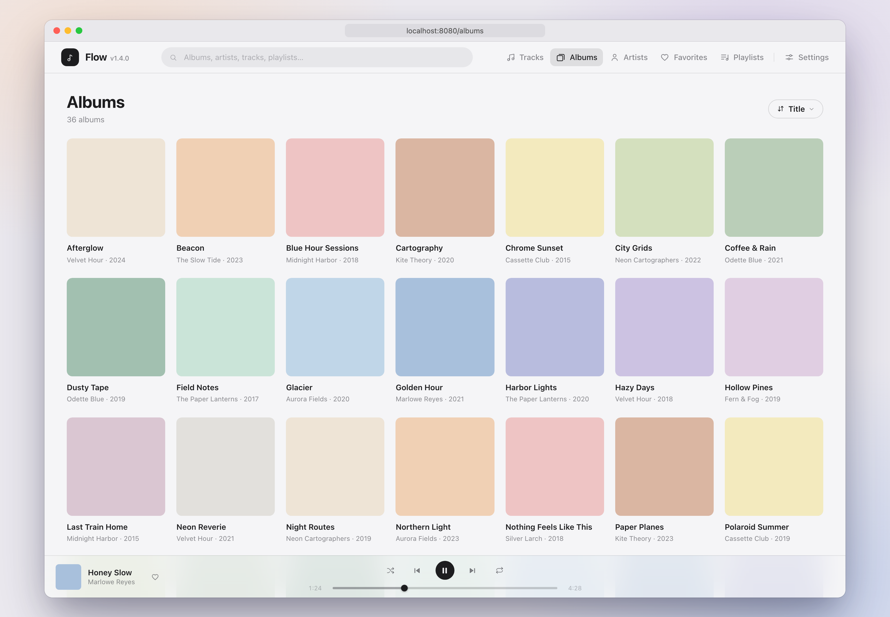

<div align="center">

<picture>
  <source media="(prefers-color-scheme: dark)" srcset="assets/logo-dark.svg">
  
</picture>

<h1>Flow</h1>

<p>
  <strong>Your music, streamed from your own server.</strong>
</p>

<p>
  <a href="https://github.com/polius/Flow/actions/workflows/ci.yml"></a>
  <a href="https://github.com/polius/Flow/actions/workflows/release.yml"></a>
  <a href="https://github.com/polius/Flow/releases"></a>
  <a href="https://hub.docker.com/r/poliuscorp/flow"></a>
  <a href="LICENSE"></a>
</p>



</div>

## Features

- **Your library, as it is.** MP3, FLAC, M4A, and OGG, organized by their tags. New files show up on their own.
- **Plays well.** Gapless playback, volume normalization, and keyboard shortcuts (press `?`).
- **Favorites, playlists, and a queue** saved on the server, so any browser picks up where you left off.
- **Edit tags without touching your files.** Edits live in Flow's database.
- **Repairs files browsers can't play**, such as stream rips saved as `.mp3`.
- **Works on your phone**, added to the Home Screen like an app.

## Quick demo

```bash
docker run --rm -e DEMO=true -p 8080:8080 poliuscorp/flow
```

Open http://localhost:8080. The demo tracks are silent placeholders.

## Set up

```bash
curl -O https://raw.githubusercontent.com/polius/Flow/main/docker-compose.yml
docker compose up -d
```

This creates a `flow/` folder next to the compose file. Put your music in `flow/music/`.

> If your music belongs to another user (Synology is often `1026:100`, Unraid `99:100`), set `PUID` and `PGID` to match.

## Adding music

Copy files into `flow/music/`, in any folder structure. Albums and artists come from the files' tags, not folder names; untagged files use the file name as the title.

New, changed, and deleted files are picked up automatically. To scan right away, use **Settings → Library → Rescan**.

### Browser support

Flow streams files as they are, without transcoding:

| Format | Chrome, Edge, Firefox | Safari |
| --- | --- | --- |
| MP3, FLAC, M4A (AAC) | ✓ | ✓ |
| M4A (ALAC) | ✗ | ✓ |
| OGG (Vorbis, Opus) | ✓ | Recent versions |

## On your phone

Open Flow in the browser and add it to the Home Screen (**Share → Add to Home Screen** on iPhone, **Install app** on Android). Pick a light or dark icon in **Settings → Appearance**.

## Password

**There's no password by default**, so anyone who can reach the port can use Flow. Set one in **Settings → Access**, or with `FLOW_PASSWORD`.

Forgot it? Start the container once with `FLOW_RESET_PASSWORD=1`, then remove the variable.

## HTTPS and reverse proxies

Put Flow behind a reverse proxy for HTTPS, and publish the port on localhost only (`"127.0.0.1:8080:8080"`). The proxy must not buffer responses, must allow 12 MB uploads, and must send `X-Forwarded-For` and `X-Forwarded-Proto`. Set `FLOW_TRUSTED_PROXIES` to the proxy's address.

**Caddy**

```caddy
music.example.com {
    reverse_proxy 127.0.0.1:8080 {
        flush_interval -1
    }
}
```

**nginx**

```nginx
location / {
    proxy_pass http://127.0.0.1:8080;
    proxy_http_version 1.1;
    proxy_set_header Host $host;
    proxy_set_header X-Forwarded-For $proxy_add_x_forwarded_for;
    proxy_set_header X-Forwarded-Proto $scheme;
    proxy_buffering off;
    proxy_read_timeout 1h;
    client_max_body_size 12m;
}
```

## Backups

Everything Flow creates lives in `flow/data/`; your music is never modified. Stop the container before copying it:

```bash
docker compose stop && cp -a flow/data flow-data-backup && docker compose start
```

## Upgrading

```bash
docker compose pull && docker compose up -d
```

Flow backs up its database before upgrading it. To roll back, set the previous version's tag (for example `poliuscorp/flow:1.5.0`) and run `docker compose up -d`; you may need to sign in again.

After upgrading, run **Settings → Library → Full rescan** once to re-check and repair every file with the new version.

## Configuration

All optional.

| Variable | Default | What it does |
| --- | --- | --- |
| `FLOW_PASSWORD` | – | Sets the password on start if none is set. |
| `FLOW_RESET_PASSWORD` | – | `1` removes the password and signs everyone out. |
| `PUID`, `PGID` | `1000` | User and group Flow runs as. |
| `FLOW_TRUSTED_PROXIES` | – | Reverse proxy addresses or CIDRs. |
| `FLOW_WATCHER` | `auto` | `native`, `polling`, or `auto`. Use `polling` for network shares. |
| `FLOW_POLL_INTERVAL` | `60` | Seconds between checks in polling mode. |
| `FLOW_WATCH_DEBOUNCE` | `2` | Seconds to wait for changes to settle before scanning. |
| `FLOW_REPAIR` | `on` | `off` turns off repairing unplayable files. |
| `FLOW_AUTO_HEAL` | `on` | `off` skips the file re-check after an upgrade. |
| `FLOW_LOG_LEVEL` | `INFO` | `DEBUG`, `INFO`, `WARNING`, or `ERROR`. |
| `DEMO` | – | `true` fills an empty library with silent demo tracks. |

## Security

To report a vulnerability, see [SECURITY.md](SECURITY.md).

## License

Released under the [MIT License](LICENSE).
